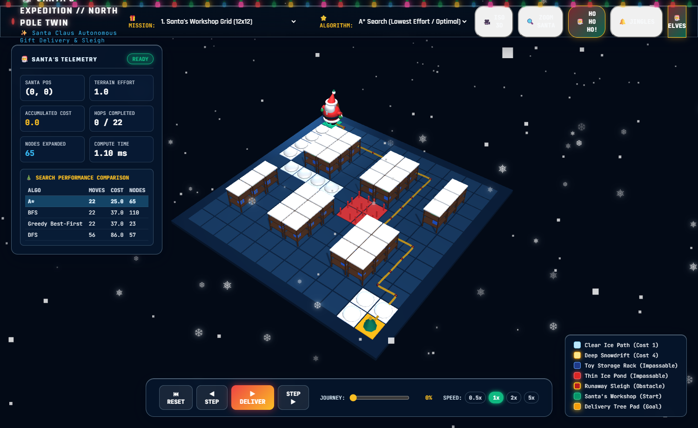
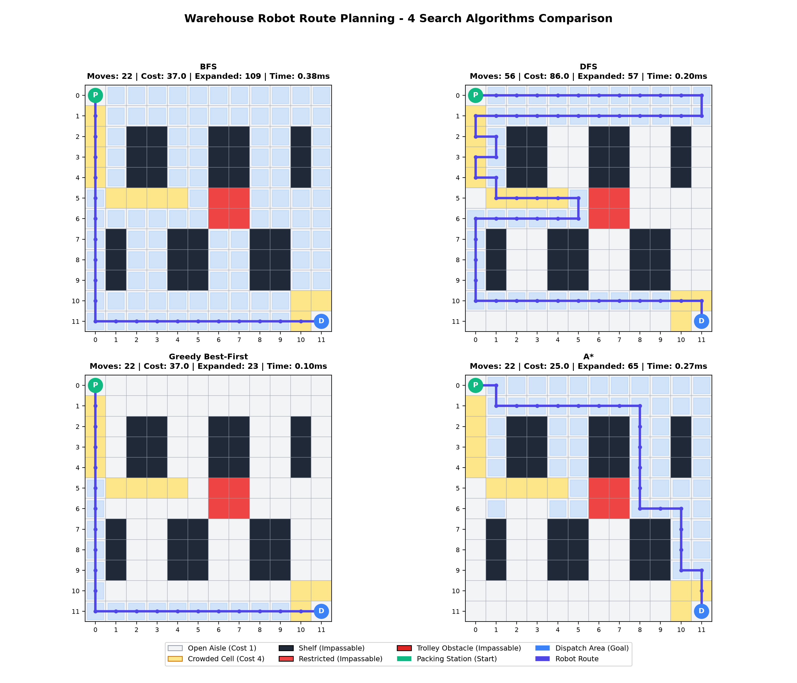
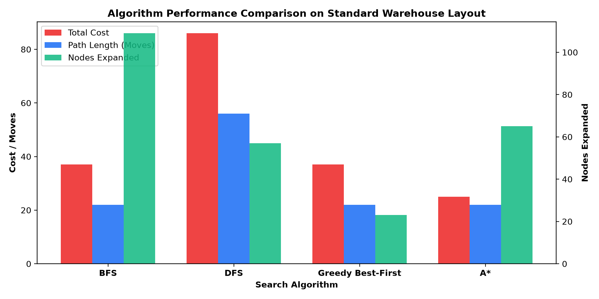
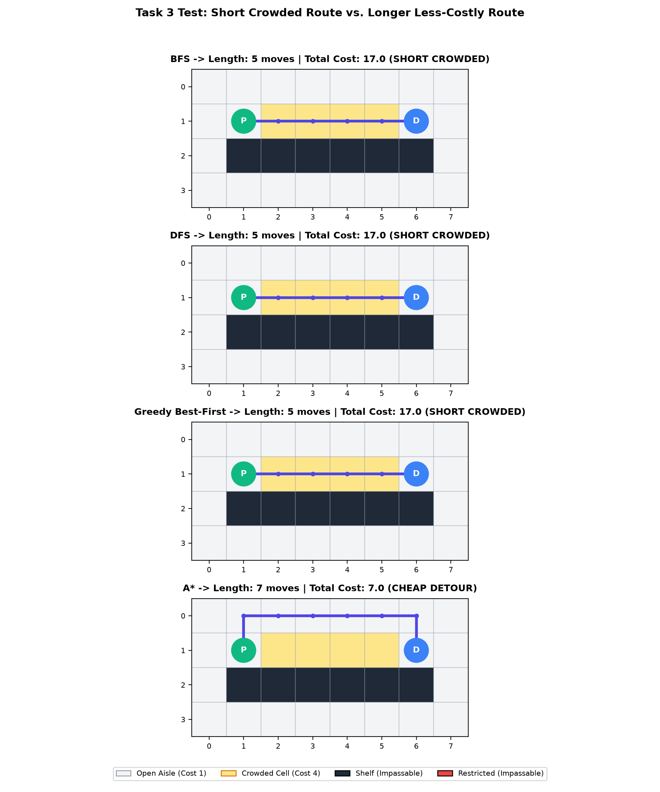
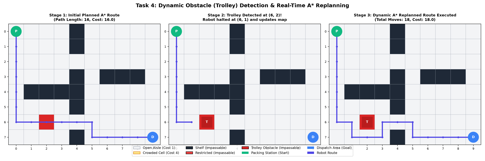
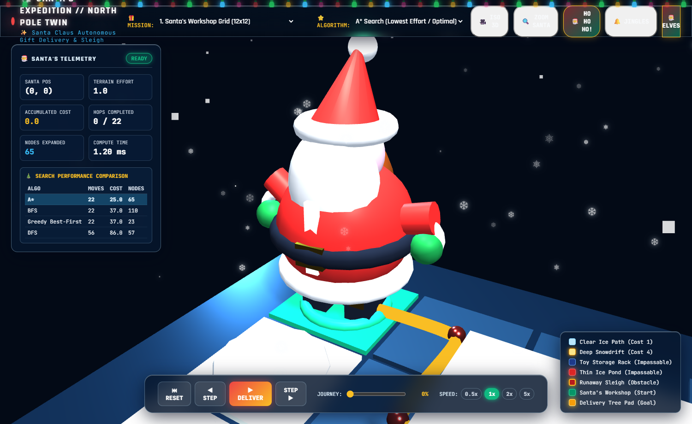
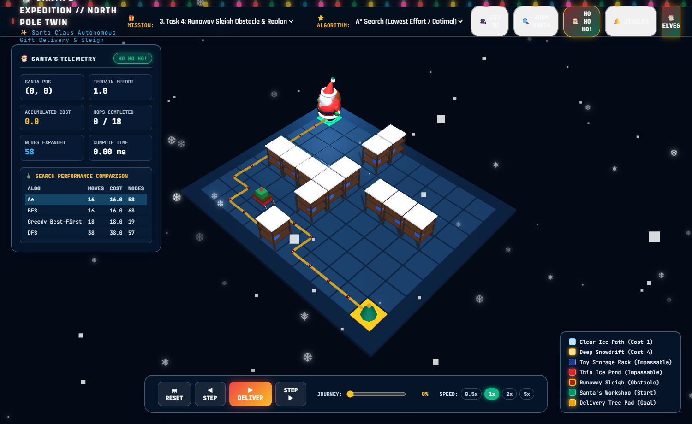
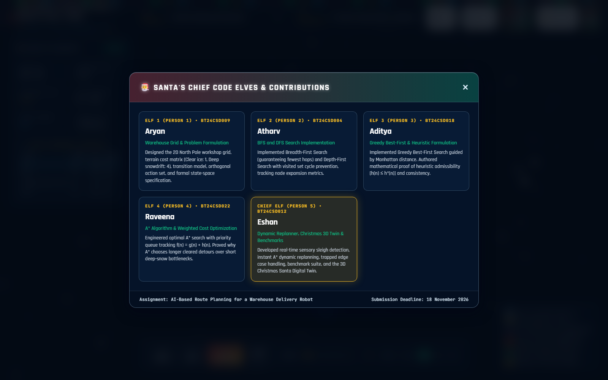

# AI-Based Route Planning for an Autonomous Warehouse Delivery Robot
**Course Assignment: Artificial Intelligence**  
**Submission Target:** `bmakhija@iiitn.ac.in` | **Suggested Repo Name:** `AI_Warehouse_PathPlanning_GroupXX`  
**Deadline:** 18 November 2026


*Figure 1: Interactive Three.js 3D Digital Twin — North Pole Santa Claus Expedition with Live Telemetry HUD, Twinkling Fairy Lights, and Golden Ribbon Navigation.*

---

## 👥 Group Members & Division of Responsibilities

| Member | Name | Roll Number | Primary Role & Responsibility | Core Tasks & Code Modules |
| :---: | :---: | :---: | :--- | :--- |
| **Person 1** | **Aryan** | **BT24CSD009** | **Warehouse Grid & Search Problem Formulation** | Task 1 & Task 2: Formal state space, transition model, cost matrices, ASCII grid rendering (`warehouse/grid.py`). |
| **Person 2** | **Atharv** | **BT24CSD004** | **Uninformed Search Algorithms (BFS & DFS)** | Task 3 (Part 1): Breadth-First Search (shortest moves guarantee) and Depth-First Search with visited set cycle prevention (`warehouse/algorithms.py`). |
| **Person 3** | **Aditya** | **BT24CSD018** | **Greedy Best-First Search & Heuristic Formulation** | Task 3 (Part 2): Greedy Best-First Search, Manhattan distance heuristic design, mathematical proofs for admissibility and consistency (`warehouse/algorithms.py`). |
| **Person 4** | **Raveena** | **BT24CSD022** | **A* Search & Weighted Cost Optimization** | Task 3 (Part 3): A* priority queue graph search, cost optimization, Task 3 dilemma (short crowded vs. long cheap route) (`warehouse/algorithms.py`). |
| **Person 5** | **Eshan** | **BT24CSD012** | **Dynamic Trolley Replanner, 3D Web UI & Benchmarks** | Task 4 & Task 5: Real-time sensor scanning, A* dynamic replanning, trapped edge case, benchmark suite, Matplotlib figures, and interactive Three.js 3D Digital Twin (`warehouse/replanner.py`, `warehouse/benchmark.py`, `warehouse/visualizer.py`, `web_3d/`). |

---

## 📌 Executive Summary & Technical Innovations

This project delivers an industrial-grade route planning and dynamic obstacle avoidance system for an Automated Guided Vehicle (AGV) navigating a 2D warehouse grid.

Key Deliverables:
1. **Simplified & Explainable Codebase:** Modular, cleanly typed, zero-bloat Python architecture with full Russell & Norvig problem formulation.
2. **Complete Algorithmic Implementations:** BFS, DFS, Greedy Best-First, and A* evaluated across identical environments.
3. **Formal Mathematical Proofs:** Strict proofs for Manhattan distance admissibility ($h(n) \le h^*(n)$) and consistency (monotonicity).
4. **Task 3 Dilemma Validated:** Empirically proves that **the shortest route in moves does not necessarily have the lowest cost** in weighted environments.
5. **Dynamic Obstacle Detection & Real-Time Replanning:** Simulates sensor lookahead, dynamic map updates, and immediate A* recalculation when encountering an unmapped trolley.
6. **Photorealistic 3D Digital Twin (Three.js):** An interactive 3D browser-based warehouse simulation with procedural AGV robot, rotating LiDAR beam, audio synthesizer, and custom grid sandbox.

---

## 📐 Task 2: Formal Search Problem Formulation

Following the standard Russell & Norvig Artificial Intelligence framework:

1. **State Space ($S$):**  
   $$S = \{ (r, c) \mid 0 \le r < H, \; 0 \le c < W \}$$  
   Each discrete state is a 2D grid coordinate $(r, c)$ on the warehouse floor.

2. **Initial State ($s_0$):**  
   $$s_0 = (r_{\text{start}}, c_{\text{start}}) \quad \text{[Packing Station, e.g., } (0, 0)\text{]}$$

3. **Action Space ($A(s)$):**  
   Orthogonal 4-directional moves:
   $$A = \{ \text{UP}: (-1, 0), \; \text{DOWN}: (+1, 0), \; \text{LEFT}: (0, -1), \; \text{RIGHT}: (0, 1) \}$$

4. **Transition Model ($\text{Result}(s, a)$):**  
   $$\text{Result}((r, c), (\Delta r, \Delta c)) = (r + \Delta r, \; c + \Delta c)$$  
   Valid if and only if:
   - $0 \le r + \Delta r < H$ and $0 \le c + \Delta c < W$ (within grid bounds)
   - $\text{Grid}[r + \Delta r][c + \Delta c] \notin \{ \text{SHELF}, \; \text{RESTRICTED}, \; \text{TROLLEY} \}$ (free of impassable obstacles)

5. **Goal Test ($\text{IsGoal}(s)$):**  
   $$\text{IsGoal}(s) \iff s == (r_{\text{dest}}, c_{\text{dest}}) \quad \text{[Dispatch Area]}$$

6. **Step-Cost Function ($c(s, a, s')$):**  
   $$c(s, a, s') = \begin{cases} 
   1.0 & \text{if } s' \text{ is an OPEN aisle} \\ 
   4.0 & \text{if } s' \text{ is a CROWDED aisle (forklift/worker traffic)} \\ 
   \infty & \text{if } s' \text{ is a SHELF, RESTRICTED, or TROLLEY} 
   \end{cases}$$

7. **Path-Cost Function ($g(p)$):**  
   $$g(p) = \sum_{i=1}^{k} c(s_{i-1}, a_i, s_i)$$

---

## 🧠 Task 3: Heuristic Justification & Mathematical Proof

### Manhattan Distance Heuristic Definition
$$h((r, c)) = |r - r_{\text{goal}}| + |c - c_{\text{goal}}|$$

### Proof of Admissibility (Lower Bound on Remaining Travel Cost)
- An admissible heuristic never overestimates the true cost to reach the goal: $h(n) \le h^*(n)$.
- Because the robot is strictly restricted to orthogonal moves along grid axes, the absolute minimum number of steps required to reach $(r_{\text{goal}}, c_{\text{goal}})$ from $(r, c)$ in an empty, obstacle-free grid is $|\Delta r| + |\Delta c|$.
- In the warehouse environment, the minimum step cost to enter any valid cell is $c_{\min} = 1.0$ (open aisle). Crowded aisles cost $4.0 > 1.0$, and physical barriers (shelves, restricted zones) force longer detours.
- Therefore, the true optimal remaining cost $h^*(n)$ satisfies:
  $$h^*(n) \ge c_{\min} \cdot (|\Delta r| + |\Delta c|) = 1.0 \cdot h(n) = h(n)$$
- Hence, $h(n) \le h^*(n)$, establishing that Manhattan distance is **strictly admissible**.

### Proof of Consistency (Monotonicity)
- A heuristic is consistent if for every node $n$ and every successor $n'$ generated by action $a$:
  $$h(n) \le c(n, a, n') + h(n')$$
- By the triangle inequality on Manhattan distance:
  $$|h(n) - h(n')| \le |\Delta r| + |\Delta c| = 1.0$$
- Since every transition incurs a cost $c(n, a, n') \ge 1.0$:
  $$h(n) - h(n') \le 1.0 \le c(n, a, n') \implies h(n) \le c(n, a, n') + h(n')$$
- **Consequence:** Because $h(n)$ is consistent, A* graph search is guaranteed to find an optimal path without needing to reopen nodes once they are added to the closed/explored set.

---

## 📊 Performance Benchmarks & Findings (Task 5)

### Experiment 1: Standard Warehouse Grid (12×12)
Comprehensive comparison across the default warehouse layout featuring shelves, restricted zones, and crowded traffic areas:

| Algorithm | Goal Reached | Path Length (Moves) | Total Path Cost | Nodes Expanded | Execution Time (ms) |
| :--- | :---: | :---: | :---: | :---: | :---: |
| **BFS** | YES | **22** | 37.0 | 109 | 0.361 |
| **DFS** | YES | 56 | 86.0 | 57 | 0.194 |
| **Greedy Best-First** | YES | **22** | 37.0 | **23** | **0.096** |
| **A\*** | YES | **22** | **25.0** | 65 | 0.275 |




### Key Insights:
1. **A\* vs. BFS & Greedy:** While BFS, Greedy, and A* all found paths with 22 moves, BFS and Greedy chose paths through high-cost crowded cells (Total Cost: 37.0). In contrast, **A* found a path with Total Cost of only 25.0**, avoiding crowded cells wherever possible.
2. **Greedy Best-First Search:** Expanded the fewest nodes (23 nodes) and was fastest (0.096 ms), but operates blindly with respect to step costs $g(n)$.
3. **DFS Inadequacy:** DFS generated an erratic, convoluted path of 56 moves costing 86.0, demonstrating why depth-first search is unsuitable for production warehouse robotics.

---

### Experiment 2: Task 3 Dilemma — Short Crowded Route vs. Longer Cheap Route
The PDF explicitly requires:
> *"Test a short, crowded route against a longer, less costly route. Explain whether the shortest route also had the lowest cost."*



| Algorithm | Goal Reached | Path Length (Moves) | Total Path Cost | Route Classification |
| :--- | :---: | :---: | :---: | :--- |
| **BFS** | YES | **5** | 17.0 | Short Crowded Bottleneck ($4 \times 4 + 1$) |
| **DFS** | YES | **5** | 17.0 | Short Crowded Bottleneck |
| **Greedy Best-First** | YES | **5** | 17.0 | Short Crowded Bottleneck |
| **A\*** | YES | 7 | **7.0** | **Longer Open Detour ($7 \times 1$)** |

### 💡 Core Theoretical Finding:
> **Does the shortest route also have the lowest cost?**  
> **NO.** In environments with non-uniform traversal costs (e.g., crowded aisles with cost 4 vs. open aisles with cost 1):
> - **BFS** minimizes the *number of edge transitions* (path length = 5 moves), resulting in a high cost of **17.0**.
> - **Greedy Best-First** follows the steepest heuristic descent directly toward the destination, also getting trapped in the crowded 5-move corridor (**cost 17.0**).
> - **A\*** evaluates $f(n) = g(n) + h(n)$ and correctly identifies that taking a 7-step detour around the corridor incurs a total cost of only **7.0** (a **58.8% cost reduction**).
> - **Conclusion:** In weighted state spaces, **path length and path cost are fundamentally distinct objective functions**. A* is required whenever energy consumption, time, or cost is the optimization target.

---

## 🚧 Task 4: Dynamic Obstacle Detection & Real-Time Replanning



### Replanning Lifecycle Walkthrough:
1. **Stage 1 (Initial Offline Route):**  
   Robot plans an optimal A* path based on its baseline warehouse map (Path Length: 16 moves, Cost: 16.0). The trolley at `(6, 2)` is omitted from this initial map.
2. **Stage 2 (Sensory Detection & Halt):**  
   The robot advances to coordinate `(6, 1)`. Its forward proximity sensor scans the adjacent cell `(6, 2)` and detects an unexpected blockage (`TROLLEY`). The robot immediately halts.
3. **Stage 3 (Belief Map Update & Dynamic A* Replan):**  
   The robot updates its internal belief map: $\text{Grid}[6][2] \leftarrow \text{TROLLEY}$. It re-invokes A* with the current coordinate `(6, 1)` as the new start state. A* computes a dynamic bypass route through row 7 in **0.120 ms**.
4. **Stage 4 (Execution to Dispatch):**  
   The robot successfully completes the mission with 18 total moves and an executed cost of 18.0 (1 replan executed).

### Edge Case Handling: Trapped Robot (No Alternative Route)
When a dynamic trolley completely seals off the only available corridor to the dispatch area, the system detects the failure cleanly:
```text
CRITICAL: Trolley detected at (2, 2). Robot trapped at (1, 2). No alternative route exists!
Replans Attempted: 1 | Goal Reached: False
```

---

## 🌐 Three.js 3D Digital Twin (Interactive Web UI)

An interactive 3D Web UI built with Three.js provides a realistic, festive digital twin of the warehouse expedition.

### Website Interface Gallery

| 🎅 3D Santa Close-Up | 🦌 Runaway Sleigh Dynamic Replanning |
| :---: | :---: |
|  |  |
| *Procedural 3D Santa with crimson suit, white beard, gold buckle & toy sack* | *Obstacle detection alert & real-time A\* dynamic detour replanning* |

| 👥 Chief Code Elves Modal | 📊 Matplotlib Benchmark Comparison |
| :---: | :---: |
|  |  |
| *Interactive group attribution modal for all 5 team members* | *Publication 2D benchmark figure generated via Python* |

```
web_3d/
├── index.html        # HTML5 layout with telemetry HUD, scenario selector, speed controls
├── style.css         # Winter wonderland glassmorphism dark theme with falling snowflakes & fairy lights
├── app.js            # Three.js 3D engine, procedural Santa, Web Audio synth ("HO HO HO!"), live search engine
└── sim_data.json     # Precomputed simulation traces for offline playback
```

### Key UI Features:
- **Procedural 3D Santa Claus Model:** Plump jolly belly, crimson coat with white fur trim, black boots with golden buckles, black leather belt, fluffy white beard & moustache, iconic red Santa hat with pom-pom, green mittens, and a giant burlap sack slung over his shoulder bulging with wrapped presents and candy canes.
- **Dedicated Santa Spotlight & Zoom:** Follow spotlight illuminating Santa on the ice, plus a dedicated `🔍 ZOOM SANTA` button for close-up inspection.
- **Twinkling Holiday Fairy Lights:** Multi-colored holiday bulbs (red, green, gold, blue, pink) hanging across the top navigation bar with twinkling animations.
- **CSS & 3D Falling Snow Particles:** Dual-layer snowfall (650 3D snow particles drifting in the scene plus swaying CSS snowflake overlays across the screen).
- **Golden Holiday Ribbon Route:** Displays the planned path spline in glowing golden holiday ribbon dotted with red Christmas ornament baubles.
- **Embedded Web Audio Synthesizer:** Multi-harmonic jingle bells on every step, synthesized deep "HO! HO! HO!" laugh upon starting delivery, sleigh warning horns, and classic "Jingle Bells" victory fanfare.
- **Scenario & Algorithm Switcher:** Switch between Standard, Cost vs. Length, Sleigh Replanning, Trapped Santa, and Winter Sandbox.
- **Interactive Sandbox Brush Tool:** Click directly on any 3D floor tile to drop toy racks, deep snowdrifts, runaway sleighs, or change start/goal coordinates!

---

## 🚀 How to Run the Project

### Prerequisites
- Python 3.10+ (Tested on Python 3.13)
- Modern web browser (Chrome, Edge, Firefox)

Install standard dependencies:
```bash
pip install -r requirements.txt
```

### 1. Run Automated Simulation & Generate Report Figures
```bash
python run_simulation.py
```
This runs all 4 experiments, prints comparison tables and analytical findings, and outputs publication figures into `docs/figures/`.

### 2. Run Interactive Command-Line Menu
```bash
python main.py
```
Options available in the interactive menu:
```text
Select an option:
  1. Run All Algorithms on Standard Warehouse (12x12)
  2. Run Task 3 Test: Short Crowded vs. Long Cheap Detour
  3. Run Task 4 Demo: Dynamic Trolley Obstacle & A* Replanning
  4. Run Task 4 Edge Case: Trapped Robot (No Route Exists)
  5. Run Complete Benchmark Suite & Export Figures
  6. Launch 3D Three.js Interactive Warehouse Web App
  7. Exit
```

### 3. Run Unit Test Suite
```bash
python -m unittest discover tests
```
Validates mathematical properties, heuristic admissibility, search optimality, and replanning edge cases.

### 4. Launch 3D Three.js Web Application
```bash
python main.py --web
```
Or start a simple HTTP server in the project root:
```bash
python -m http.server 8080 --directory web_3d
```
Then open `http://localhost:8080` in your web browser.

---

## 🎓 Viva Voce Evaluation Guide (Member-by-Member Q&A)

### Person 1: Aryan (Warehouse Grid & Problem Formulation)
- **Q: How did you define the state space and step-cost function?**  
  *Answer:* State is a discrete tuple $(r, c)$ bounded by the grid dimensions. Step cost is non-uniform: entering an open cell costs 1.0, while entering a crowded aisle costs 4.0. Shelves and restricted zones are modeled with infinite cost to enforce impassability.
- **Q: Why are actions limited to orthogonal moves?**  
  *Answer:* Warehouse robots navigate designated rectilinear aisles to avoid collisions with racking infrastructure; orthogonal moves align with the Manhattan distance metric.

### Person 2: Atharv (BFS & DFS Search)
- **Q: Why does BFS guarantee the fewest moves but not the lowest cost?**  
  *Answer:* BFS explores the search tree level by level using a FIFO queue. The shallowest goal node is guaranteed to have the minimal edge count. However, BFS assumes uniform edge weights of 1; it cannot distinguish between a cell of cost 1 and cost 4.
- **Q: How did you prevent cycles in DFS?**  
  *Answer:* We implemented graph search using a `visited` set. Before expanding a state popped from the LIFO stack, we check if it has already been explored.

### Person 3: Aditya (Greedy Best-First & Heuristic Proof)
- **Q: Why is Manhattan distance admissible for this problem?**  
  *Answer:* With orthogonal moves, Manhattan distance $|\Delta r| + |\Delta c|$ is the exact minimum number of steps needed in an obstacle-free grid. Since the lowest possible step cost is 1.0, $h(n) \le h^*(n)$ always holds.
- **Q: What is the weakness of Greedy Best-First Search?**  
  *Answer:* It prioritizes nodes solely based on $h(n)$, completely ignoring accumulated cost $g(n)$. This makes it vulnerable to stepping into high-cost crowded cells or getting stuck in dead ends.

### Person 4: Raveena (BT24CSD022) (A* & Weighted Path Costs)
- **Q: How does A* resolve the dilemma between a short crowded route and a long cheap detour?**  
  *Answer:* A* minimizes $f(n) = g(n) + h(n)$. For the short crowded corridor, $g(n)$ accumulates $4 \times 4 = 16$. For the longer open detour, $g(n)$ accumulates $7 \times 1 = 7$. Because $7 < 16$, A* correctly chooses the longer, less costly route.
- **Q: Why doesn't A* need to reopen closed nodes in our implementation?**  
  *Answer:* Because Manhattan distance satisfies consistency (triangle inequality $|h(n) - h(n')| \le 1.0 \le c(n, a, n')$), the first time A* expands any node, it has already found the optimal cost to that node.

### Person 5: Eshan (BT24CSD012) (Dynamic Replanning, 3D Web UI & Benchmarks)
- **Q: How does the robot detect the trolley before colliding with it?**  
  *Answer:* At each step, the robot simulates a forward proximity scan of the next cell in its planned path. If the ground truth map has a trolley at that location, the robot halts, updates its internal map, and triggers A* from its current coordinates.
- **Q: What happens if the trolley leaves no alternative path to the goal?**  
  *Answer:* When A* replans from the current position and the priority queue empties without finding the goal, the system catches the condition and raises an explicit `CRITICAL: No alternative path exists` alert.

---

## 📧 Email Submission Draft

**To:** `bmakhija@iiitn.ac.in`  
**Subject:** `AI Group Coding Assignment Submission – Group XX`

> Respected Sir,  
>  
> Please find our submission for the **AI Group Coding Assignment: AI-Based Route Planning for a Warehouse Delivery Robot**.  
>  
> **Group Details:**  
> - **Group Number:** Group XX  
> - **GitHub Repository:** `https://github.com/AryanKarmore/santas-warehouse-of-wonders`  
>  
> **Member Roster & Contributions:**  
> 1. **Aryan (BT24CSD009)** — Warehouse Environment & Problem Formulation (Tasks 1 & 2)  
> 2. **Atharv (BT24CSD004)** — BFS & DFS Graph Search Implementation (Task 3)  
> 3. **Aditya (BT24CSD018)** — Greedy Best-First Search & Manhattan Distance Heuristic Proof (Task 3)  
> 4. **Raveena (BT24CSD022)** — A* Search & Weighted Path Cost Analysis (Task 3)  
> 5. **Eshan (BT24CSD012)** (Group Representative) — Trolley Replanning, Benchmarking, Performance Evaluation & Three.js 3D Digital Twin (Tasks 4 & 5)  
>  
> All source code, automated test suites, Matplotlib figures, and the interactive Three.js 3D Digital Twin are included in the repository.  
>  
> Sincerely,  
> Group XX Representative (Eshan)
